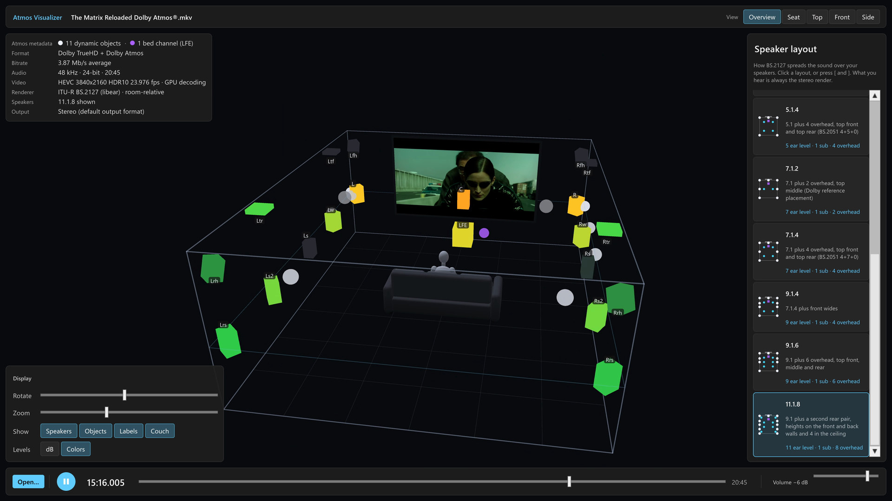
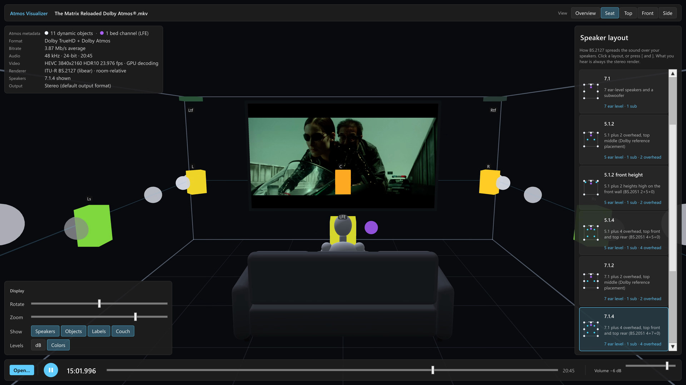
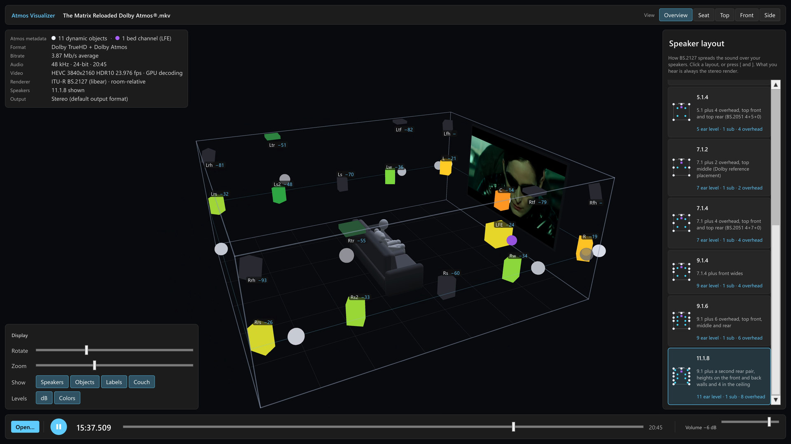
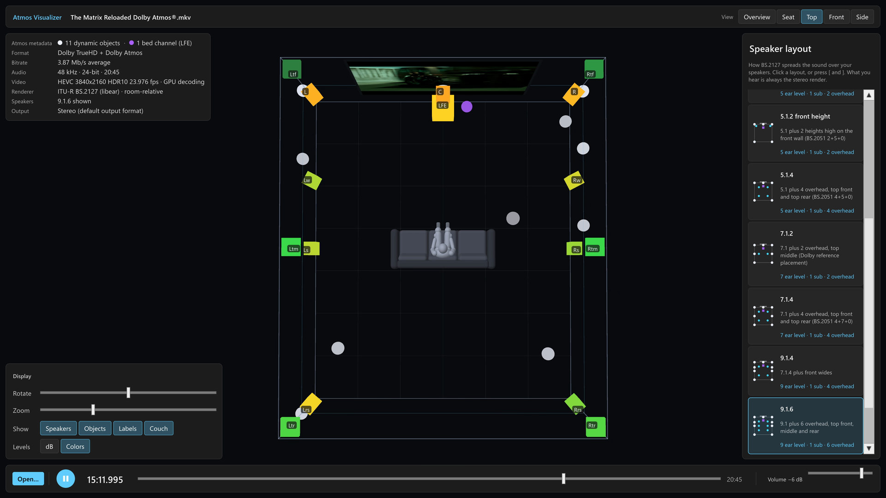

# Atmos Visualizer

**See inside a movie's Dolby Atmos mix.** Atmos Visualizer takes the Dolby Atmos track (TrueHD or
Dolby Digital Plus) straight from a movie file, decodes every audio object and how it moves, and
renders the whole film into a virtual home theater with the speaker layout of your choice, from
5.1.2 to 11.1.8. The movie plays on the room's screen. Every object flies around the room as a
dot, and every speaker lights up with the level the renderer sends it. You hear a stereo render
through your PC speakers.

https://github.com/user-attachments/assets/d6464040-1aea-45a4-abd6-28897d7a1ef1

Seeing a mix like this usually takes a high-end home-theater processor with an object viewer, or
professional mixing software. This is a free, open-source app for a Windows PC.

It renders with **libear**, the C++ core of the EBU's reference renderer for **ITU-R BS.2127**,
using BS.2127's room-relative panning. It is not Dolby's renderer, so a Dolby-licensed processor
may place sound somewhat differently.

> **Windows only, for now.** It runs on Windows 10 and 11, 64-bit. Download it below, or build it
> yourself with Unity: see [Building and running](#building-and-running).

## Download

1. Download the Windows zip from the
   [latest release](https://github.com/christianroman/atmos-visualizer/releases/latest) and unzip
   it anywhere. Keep the folder together: the app needs the files next to it.
2. Install ffmpeg and MKVToolNix (see [Requirements](#requirements)). harletty, the Atmos
   decoder, comes with the app.
3. Run `AtmosVisualizer.exe`. The app isn't code-signed yet, so Windows may say it protected your
   PC: choose **More info**, then **Run anyway**.

## What it shows

- **Movies straight from their files**, when they have a Dolby Atmos track: TrueHD (as on UHD
  Blu-ray) or Dolby Digital Plus (as in streaming downloads and most demo clips). The Atmos
  objects are decoded once and cached; the picture plays live from the original file (GPU
  decoding, HDR10 tone-mapped).
- **Dolby Atmos masters** (`.atmos`), on their own or with a film's picture.
- **Eleven speaker layouts**, switchable while playing: 2.0, 5.1, 7.1, 5.1.2 (top middle or front
  height), 5.1.4, 7.1.2, 7.1.4, 9.1.4, 9.1.6, 11.1.8. You can add your own (see below).
- **Speakers** glow with their rendered level. Optionally they show the level in dB, or use
  green-to-red level colors that follow the volume, like a home theater processor's display.
- **Objects** as white dots and **bed channels** (such as the LFE) as fixed purple dots, with a
  seated listener on a couch for scale.
- **Five views** (Overview, Seat, Top, Front, Side), plus free orbit and zoom.
- **Media details**: object and bed counts, format, bitrate, video, renderer.

## Screenshots

<p>
  <a href="images/overview.jpg"></a>
  <a href="images/seat.jpg"></a>
  <a href="images/levels.jpg"></a>
  <a href="images/top.jpg"></a>
</p>

*Overview on 11.1.8 · Seat view on 7.1.4 · Level colors and dB readouts on 11.1.8 · Top view on
9.1.6 (click to enlarge)*

## Supported files

| What | File types | Notes |
|---|---|---|
| Movies with a **Dolby TrueHD Atmos** track | `.mkv`; also `.mka` `.m2ts` `.ts` `.mp4` `.m4v` `.mov`, not yet tested | Decoded once and cached. The picture plays from the same file. |
| Movies with a **Dolby Digital Plus Atmos** track (E-AC-3 JOC) | `.mkv`, and raw `.ec3` demo clips; also `.mp4` and the others above, not yet tested | Decoded once and cached. A file with both tracks uses TrueHD. See the note below. |
| **Dolby Atmos master files** (DAMF) | `.atmos`, with its `.atmos.metadata` and `.atmos.audio` beside it | To see one with a film's picture, open the film first and then the `.atmos` (same length), or select both in **Open…** when they're in one folder. |

**About Dolby Digital Plus.** DD+ carries Atmos as a 5.1 mix plus instructions for rebuilding the
objects from it, so its objects are close to the original mix but not exact. harletty marks its
DD+ decoding as experimental. Checked against Dolby's own encoder on a known test mix: every
object came back in the right place, and 90% of the time each speaker's level was within 2 dB of
the original, with the ceiling speakers 1 to 2 dB low.

Not supported: other immersive formats, such as DTS:X, Auro-3D or ADM BWF files.

## Requirements

### To run it

- Windows 10 or 11, 64-bit.
- A GPU that decodes 4K HEVC (any recent NVIDIA, AMD or Intel GPU) for smooth 4K playback.
- Two free tools to install, needed to open movies. The third, **harletty** (the open decoder
  that turns the Atmos track into objects; a fork of truehdd that adds Dolby Digital Plus), comes
  with the app.

| Tool | Used for | How to get it |
|---|---|---|
| **ffmpeg** (with ffprobe) | Reading the movie and playing its picture | `winget install Gyan.FFmpeg` |
| **MKVToolNix** (mkvextract) | Extracting the audio track from Matroska files | `winget install MoritzBunkus.MKVToolNix` |
| **harletty** 0.9.0 | Decoding the Atmos track (TrueHD or DD+) into objects | Included, in `StreamingAssets/Tools/harletty` |

The app looks for each tool in its settings file first, then among the tools that come with it,
then on `PATH`, then in the tool's usual install folder (MKVToolNix in Program Files). If one is
missing, the app says which. To use a tool from anywhere else, list it in
`%USERPROFILE%\AppData\LocalLow\AtmosVisualizer\Atmos Visualizer\settings.yaml`, one per line
(create the file if it isn't there):

```yaml
mkvextract: D:\Apps\MKVToolNix\mkvextract.exe
```

The names are `ffmpeg`, `ffprobe`, `mkvextract` and `harletty`.

### To build it

- **Unity 6000.3.26f1**, the version it's built and tested with, through Unity Hub. A free Unity
  Personal license is enough, and the default Windows install has everything the project needs.
- **Git**, to get the code and its submodules.
- Optional: **Visual Studio 2022** or later with the **Desktop development with C++** workload,
  only to rebuild the native plugin, which comes prebuilt.

## Getting the code

The renderer, libear, is a git submodule (with its own submodules), so clone recursively:

```bash
git clone --recursive https://github.com/christianroman/atmos-visualizer.git
```

If you already cloned without `--recursive`:

```bash
git submodule update --init --recursive
```

## Building and running

1. Install [Unity Hub](https://unity.com/download) and sign in. Unity Personal is free.
2. Install Unity **6000.3.26f1**: paste `unityhub://6000.3.26f1/de8167e7440c` into your browser's
   address bar to open it in Unity Hub, or find it in the
   [Unity download archive](https://unity.com/releases/editor/archive). The default modules are
   enough.
3. Get the code (above).
4. In Unity Hub, choose **Add → Add project from disk**, pick the `UnityProject` folder, and open
   it. The first import takes a few minutes.
5. Build the app with the menu **Atmos → Viewer → Build Player**. It writes
   `UnityProject/Builds/Viewer/AtmosVisualizer.exe`: run it directly or with `run-viewer.cmd`.
   The whole `Builds/Viewer` folder is the app, so copy the folder to move it. To try it inside
   Unity instead, open `Assets/Scenes/Viewer.unity` and press Play.
6. Install ffmpeg and MKVToolNix (above), then **Open…** a movie.

The scene is generated from code (`Assets/Editor/ViewerSetup.cs`). After changing that code, run
**Atmos → Viewer → Build Scene** to regenerate it.

The native plugin (`ear_shim.dll`: libear plus the room-relative panner) comes prebuilt in
`UnityProject/Assets/Plugins/x86_64`. To rebuild it, with Visual Studio installed, run:

```bat
native\build.cmd
```

It builds the plugin and copies it into the Unity project. The first run downloads the Boost
headers libear needs (about 30 MB, checked against its SHA-256).

## Using it

- **Open…** a movie or a `.atmos`. The welcome card also lists your recent films. Preparing a
  movie the first time takes well under a minute from a fast SSD (most of it is reading the
  file); after that it opens at once. The decoded audio is cached in
  `%LOCALAPPDATA%\AtmosVisualizer\Cache` (about 140 MB per minute of film, 180 MB for DD+);
  delete that folder to free the space.
- **Speaker layout**: click a card on the right, or press `[` and `]` (or Page Up and Page Down).
- **Camera**: drag to orbit, scroll to zoom, or use Rotate and Zoom. The view buttons are
  Overview, Seat, Top, Front and Side; click Side again for the other side.
- **Display**: Show (Speakers, Objects, Labels, Couch) and Levels (dB, Colors).
- **Volume** sets what you hear; the Level colors follow it.
- **Keys**: `Space` plays or pauses, `←` and `→` jump 5 s (30 s with `Shift`), and `Home` goes to
  the start.

### Command line

```bat
AtmosVisualizer.exe -open "D:\Movies\Movie.mkv" -layout 9.1.6
```

- `-open <file> [<file>]` opens a movie, a `.atmos`, or a `.atmos` with a movie for its picture.
- `-layout <name>` starts with that speaker layout.

### Your own speaker layout

The layouts are plain YAML files in
`UnityProject/Assets/StreamingAssets/Layouts` (in a built app,
`AtmosVisualizer_Data/StreamingAssets/Layouts`). Copy one, change the speaker names and
positions, and restart; the comments at the top of each file explain the fields.

## How it works

```
MKV ── mkvextract ──► TrueHD/DD+ ── harletty ─► Atmos objects + metadata (DAMF, cached)
 │                                                    │
 │                                    libear (ITU-R BS.2127), room-relative panning
 │                                                    │
 │                         ┌──────────────────────────┴──────────────────────────┐
 │                  speaker feeds of the chosen layout                     stereo render
 │                  (levels shown in the 3D room)                    (what you hear)
 │
 └── ffmpeg (GPU decoding) ──► the picture, synced to the audio clock
```

| Folder | What's in it |
|---|---|
| `UnityProject/Assets/AtmosEngine` | Plain C#: DAMF parsing, gains over time, audio streaming, movie preparation, video decoding |
| `UnityProject/Assets/Scripts` | The app: controller, UI (UI Toolkit), 3D room, camera |
| `native/` | `ear_shim.dll`: a C API over libear, plus BS.2127's room-relative panner ported to C++ from the EBU ADM Renderer |
| `UnityProject/Assets/StreamingAssets` | Speaker layouts (YAML) and the bundled harletty, copied into the built app as they are |
| `external/libear` | libear (submodule) |
| `tools/` | Checks against the EBU ADM Renderer (`ear`, Python; see `tools/requirements.txt`) and small C# console tools |

The app also has scripted checks (`-phase1test`, `-movietest`, `-uitest`). They run on your own
test media; the comments at the top of `UnityProject/Assets/Scripts/Phase1Test.cs` explain what
each one needs.

## License

Apache License 2.0; see [LICENSE](LICENSE). Third-party components and their licenses are listed in
[THIRD_PARTY_NOTICES.md](THIRD_PARTY_NOTICES.md).

"Dolby", "Dolby Atmos", "Dolby Digital Plus" and "TrueHD" are trademarks of Dolby Laboratories.
This project is not affiliated with or endorsed by Dolby.
